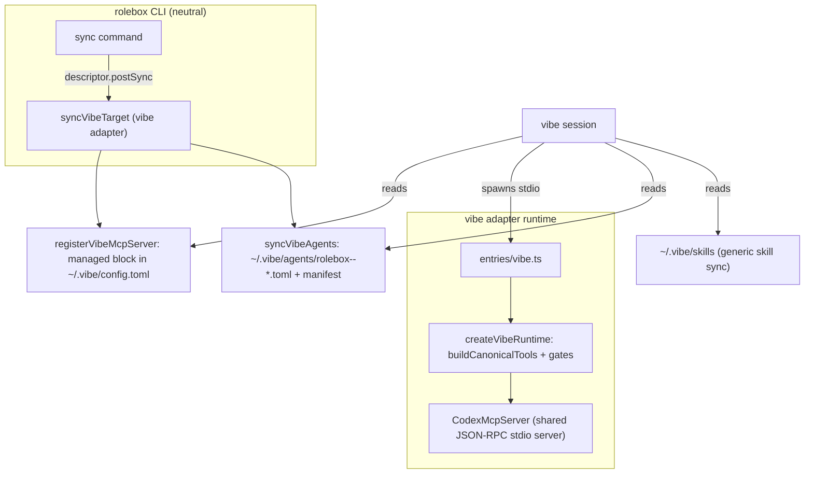

# Detailed design: Mistral Vibe CLI support for rolebox

## Overview

Add the Mistral Vibe CLI (`vibe`) as a first-class rolebox harness target at
the same support level the repo gives its other CLI-only host, Codex: public
roles become native Vibe agent files, installed skills deploy into the Vibe
user skills directory, and a rolebox stdio MCP server registered in
`~/.vibe/config.toml` exposes rolebox's canonical tool surface. Vibe documents
no programmatic session protocol, so host-driven session execution (session
browse/fork, sandboxed graph workers) is honestly excluded and declared
through the capability set.

External references:
- Vibe Code docs: https://docs.mistral.ai/llms/vibe/code/llms.txt
- Vibe MCP servers: https://docs.mistral.ai/llms/vibe/code/cli/mcp-servers/
- Vibe configuration reference: https://docs.mistral.ai/llms/vibe/code/cli/configuration-reference/

## Detailed Requirements

1. `rolebox sync vibe` deploys role symlinks to `~/.vibe/rolebox` (the generic
   sync every target gets), then runs a vibe-owned post-sync step:
   - write/refresh a managed `[[mcp_servers]]` block in `~/.vibe/config.toml`
     that starts `node <packageRoot>/dist/entries/vibe.js` on stdio;
   - regenerate native agent files for public roles under `~/.vibe/agents/`.
2. Vibe home resolves as `$VIBE_HOME` when set (non-blank), else `~/.vibe`;
   read at call time, blank treated as unset (same contract as Codex home).
3. Native agent files are named `rolebox--<role-id>.toml` (same collision-safe
   naming as Codex), carry Vibe's documented agent keys (`agent_type`,
   `display_name`, `description`, `instructions`, optionally `active_model`),
   and are idempotent: managed-file fingerprints preserve local edits and
   unmanaged files.
4. The MCP server entry (`dist/entries/vibe.js`, package export `./vibe`)
   boots the standard role runtime for platformId `vibe`, syncs skill
   symlinks and native agents, and serves the canonical tool set over
   newline-framed JSON-RPC 2.0 on stdio until stdin closes.
5. The tool surface is the canonical intersection set plus gated
   computer-use/browser families and `load_role_skill`; no session tools, no
   graph tools, no dispatch tools (no host session protocol exists).
6. `PlatformCapabilities` for vibe declares exactly that surface.
7. `rolebox status`/`info` report the vibe target and its registration state
   (detected from the managed block in `~/.vibe/config.toml`).
8. Model catalog: vibe is served from the opencode seed exactly like Codex
   (rolebox has no TOML reader); agent files project only bare model IDs and
   warn for provider-qualified models.
9. Tests cover paths, capabilities, registry descriptor, registration
   idempotency/repair, agent mapping/sync, and an MCP boot smoke test — all
   env-redirected, never touching a real home directory.
10. Documentation: `docs/vibe.md`, plus updates to `docs/compatibility.md`,
    README harness table, `CHANGELOG.md`, and `AGENTS.md` tables.

## Architecture Overview



The neutral CLI never names vibe; everything vibe-specific lives in
`src/platform/adapters/vibe/` and the single registry descriptor, matching the
repo's "single-entry change" architecture.

## Components and Interfaces

### 1. Paths — `src/platform/paths.ts`
`vibePlatformPaths(): PlatformPaths`
- `platformId: "vibe"`, `configDir` = vibe home, `agentsDir` = `{home}/agents`,
  `skillsDir` = `{home}/skills`, no `sessionsDir`/`extensionsDir`.

### 2. Capabilities — `src/platform/capabilities.ts`
`vibeCapabilities(): PlatformCapabilities`
- `platformId: "vibe"`, `hasBackgroundTasks: false`, `hasSessionFork: false`,
  `hasSessionCreate: false`, `hasSessionAbort: false`, `hasAgentFileSync: true`,
  `hasMultiStepTools: true`, `hasEventStream: false`, `hasSessionStatus: false`,
  `hasRoleSwitch: false`.

### 3. Shared managed TOML block — `src/platform/managed-config-block.ts`
Extracted from the Codex plugin-bundle writer so both CLI hosts share one
string-aware scanner:
- `interface ManagedRegion { start: number; end: number }`
- `findManagedRegions(configPath: string, content: string, markers: { start: string; end: string }): ManagedRegion[]`
- `escapeTomlString(value: string): string`
- `applyManagedBlock(configPath: string, block: string, markers): { changed: boolean }`
  (create/replace-in-place/repair-duplicates/append with single separator)
- `removeManagedBlock(configPath: string, markers): { changed: boolean }`
`src/platform/adapters/codex/installation/plugin-bundle.ts` is refactored to
delegate; its public API and byte-level behavior stay identical (guarded by
the existing codex-sync tests).

### 4. Vibe adapter — `src/platform/adapters/vibe/`
- `installation/mcp-registration.ts`
  - `VIBE_MANAGED_MARKERS` (start: `# >>> rolebox (managed) — do not edit; `rolebox sync vibe` rewrites this block >>>`, end: `# <<< rolebox (managed) <<<`)
  - `buildVibeMcpServerBlock(serverEntry: string, runtimeCommand: string): string`
    — `[[mcp_servers]]` with `name = "rolebox"`, `transport = "stdio"`,
    `command`, `args = ["<entry>"]`, `startup_timeout_sec = 60`,
    `tool_timeout_sec = 600`.
  - `registerVibeMcpServer(configPath, serverEntry, opts?) / unregisterVibeMcpServer(configPath)`
    over the shared block helpers.
- `installation/agents.ts`
  - `vibeAgentName(roleId)` — `rolebox--<id>` with the same slug+digest
    collision fallback as Codex.
  - `collectVibeAgentDescriptors(roles, options)` / `renderVibeAgent(descriptor)`
    — description from role config; instructions = role prompt + mapping
    context (canonical rolebox ID, no-authority-inheritance note, private
    children listing); `active_model` only for bare model IDs, warning
    otherwise; warnings for unsupported sampling parameters.
  - `syncVibeAgents(roles, { vibeHome, projectDir? })` — same
    fingerprint-manifest (`rolebox-agents.json`), atomic-write and
    preserve-edits semantics as the Codex agent sync; public roles only.
- `installation/sync.ts` — `syncVibeTarget({ syncTarget, report })`:
  resolve package root + version, check server entry existence (warn when the
  built entry is missing, mirroring Codex), register the MCP block, then
  resolve roles and sync native agents, reporting counts and warnings.
- `runtime.ts` — `createVibeRuntime({ directory, storeRoot, roles, computerUse, browseUse })`:
  `buildCanonicalTools` with `vibeCapabilities()`, `getEffectiveAgent` that
  resolves the acting native agent name back to a role ID (so role-visibility
  binding still works when the host identifies the caller), plus
  `load_role_skill` extra tool. No session client, no graph tools.
- `index.ts` — barrel export.

### 5. Entry — `src/entries/vibe.ts`
Mirrors `src/entries/codex.ts` minus the app-server parts: `resolveRoleboxDirectories({ platformId: "vibe" })`, `initializeRoleboxRuntime`, `syncSkillSymlinks`, `syncVibeAgents` (project roles → `{cwd}/.vibe/agents`), computer/browse gates, `createVibeRuntime`, `initialize`-handshake-aware session id (`ROLEBOX_SESSION_ID` env, then clientInfo, then `vibe:<connection-uuid>`), instructions string, `serve()` on the shared MCP server with the stdout guard. `main()` + direct-entry detection identical in shape.

### 6. Registry — `src/platform/registry.ts`
`vibeDescriptor`: id `vibe`, label `Vibe`, `vibePlatformPaths`,
`vibeCapabilities`, `postSync: syncVibeTarget`, `detectIntegration()` reading
`~/.vibe/config.toml`: registered when the vibe managed start marker is
present as a whole trimmed line (string-aware scan not needed for a status
check — the same tradeoff Codex detection documents), hint points at
`rolebox sync vibe`. Appended to `PLATFORM_REGISTRY`.

### 7. Constants / model catalog / package / CLI
- `SyncTarget.Vibe = "vibe"` (+ `SYNC_TARGET_VALUES` grows automatically).
- `MODEL_SOURCES[SyncTarget.Vibe] = { seed: SyncTarget.Opencode }`.
- `package.json` exports `./vibe` → `dist/entries/vibe.js` (+ types).
- `src/cli/commands/sync.ts` meta/description strings mention vibe;
  `src/cli/paths.ts` doc comments list the vibe rows.

## Data Models

- Vibe agent TOML (generated file):
  ```toml
  # Generated by rolebox. Edit role.yaml and sync again.
  agent_type = "agent"
  display_name = "<config.name or role id>"
  description = "<config.description or fallback>"
  instructions = "<role prompt + mapping context>"
  active_model = "<bare model id>"   # only when set and bare
  ```
- Managed config block (appended to `~/.vibe/config.toml`):
  ```toml
  # >>> rolebox (managed) — do not edit; `rolebox sync vibe` rewrites this block >>>
  [[mcp_servers]]
  name = "rolebox"
  transport = "stdio"
  command = "node"
  args = ["<absolute dist/entries/vibe.js path>"]
  startup_timeout_sec = 60
  tool_timeout_sec = 600
  # <<< rolebox (managed) <<<
  ```
- Agent manifest `{vibeHome}/rolebox-agents.json`:
  `{ "version": 1, "files": [{ "name": "rolebox--<id>.toml", "sha256": "..." }] }`
  (same shape and validation rules as the Codex manifest).

## Error Handling

- A stray managed start marker without an end marker is refused loudly (shared
  scanner contract); sync may then be re-run safely.
- Missing `dist/entries/vibe.js` (unbuilt source checkout) does not fail sync:
  the block is still written and a warning names the missing entry and
  suggests `npm run build` (Codex precedent).
- Registration failure after writing nothing: reported and re-raised, sync is
  safe to repeat.
- Agent sync preserves edited/unmanaged files with warnings; duplicates and
  inconsistent parents throw (Codex precedent).
- MCP server: tool failures become `isError` tool results; malformed envelopes
  become protocol errors; the loop never crashes or calls `process.exit`.

## Testing Strategy

Vitest, env-redirected (`VIBE_HOME`, fake `HOME`/XDG dirs), mirroring the
codex test files:
- `tests/platform/vibe-platform.test.ts` — paths (env override, blank-as-unset,
  call-time read), descriptor presence/identity, capabilities,
  `detectIntegration` (registered/unregistered), registry lookup.
- `tests/platform/adapters/vibe/installation/mcp-registration.test.ts` —
  block creation, append/replace idempotency, foreign-byte preservation,
  unregister round-trip, duplicate repair, markers inside TOML strings,
  escaped paths.
- `tests/platform/adapters/vibe/installation/agents.test.ts` — naming
  (including collision digest), rendering (keys, model projection, warnings),
  sync idempotency, edited-file preservation, stale removal, project-dir
  scoping.
- `tests/platform/adapters/vibe/runtime.test.ts` — tool surface contains the
  intersection set, no session/graph/dispatch tools; boot smoke:
  `startVibeMcpServer` + `handleLine` initialize/tools/list/tools/call
  (`memory_list`) over in-memory streams with redirected data dirs.
- Existing codex tests must stay green after the managed-block extraction
  (behavior is byte-identical).

## Appendices

### Technology choices
- Default locations over experimental plugins: plugins are documented as
  experimental and reject symlinks resolving outside the plugin dir, which
  breaks rolebox's symlink-based skill deployment. Default locations
  (`~/.vibe/agents`, `~/.vibe/skills`, `config.toml`) are documented and
  stable. Pros: robust, no format churn. Cons: no plugin-namespaced
  subagents/hooks (not needed for parity).
- Reuse of the codex JSON-RPC MCP server: it is a host-agnostic stdio server
  (no Codex SDK imports); duplicating ~500 tested lines would be worse than
  reuse. The managed-block scanner is extracted to a shared module to avoid a
  cross-adapter import of a text-file utility.
- `seed: SyncTarget.Opencode` model source: rolebox has no TOML reader; same
  decision as Codex with the same rationale.

### Alternative approaches considered
- Ship a Vibe plugin bundle (Agent Plugins 1.0): rejected — experimental
  format, symlink restriction.
- Drive vibe sessions via CLI programmatic mode for graph workers: rejected —
  no documented stable programmatic/session protocol; would invent
  undocumented behavior.
- Separate vibe MCP server implementation: rejected — duplication of a
  generic, already-tested protocol server.

### Key constraints and limitations
- No host session execution: no session browse/fork tools, no dispatch, no
  graph workers through vibe; documented in `docs/vibe.md` and
  `docs/limitations.md`.
- Vibe's `strict_config` users: the managed block uses only documented keys.
- `[[mcp_servers]]` appended at end of file is valid TOML regardless of
  preceding tables; the block is comment-delimited and repaired in place.
