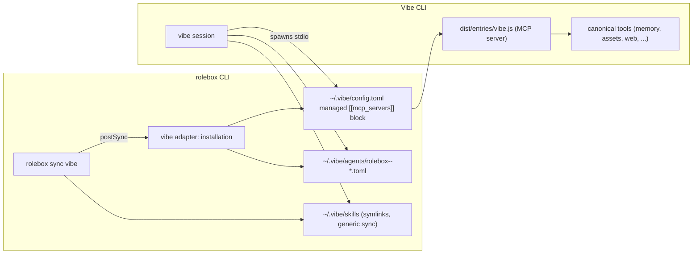

# Research: rolebox harness-integration points

Evidence gathered from the repo (commit 2f7c0e8, main).

## Registry-driven harness support
`src/platform/registry.ts` documents "Adding a new harness is a single-entry
change: append a descriptor". A `PlatformDescriptor` needs: `id`, `label`,
`paths()`, `capabilities()`, `detectIntegration()`, optional `postSync()`.
`rolebox sync <target>` calls `postSync` after the generic role-symlink sync
(src/cli/commands/sync.ts:149-157). Status/info iterate the registry.

## Codex as the CLI-host template
- Paths: `src/platform/paths.ts` — `codexPlatformPaths()` (`$CODEX_HOME` or
  `~/.codex`; configDir, agentsDir=`{home}/agents`, skillsDir=`{home}/skills`).
- Capabilities: `src/platform/capabilities.ts` — `codexCapabilities()`.
- Adapter: `src/platform/adapters/codex/` —
  - `mcp/server.ts`: generic newline-framed JSON-RPC 2.0 MCP stdio server
    (initialize/ping/tools/list/tools/call, cancellation, ordered requests).
    Host-agnostic despite the name; `mcp-protocol.ts` and `stdout-guard.ts`
    likewise.
  - `installation/plugin-bundle.ts`: managed TOML block writer
    (comment-delimited block, string-aware scanner `findManagedRegions`,
    idempotent register/unregister) + `escapeTomlString`.
  - `installation/agents.ts`: role→native-agent TOML mapping with
    sha256-fingerprint manifest (`rolebox-agents.json`), atomic writes,
    preserve-unmanaged-files policy.
  - `installation/sync.ts`: `postSync` implementation.
- Entry: `src/entries/codex.ts` — boots role runtime, syncs agents, serves MCP.
- Registration detection: line-oriented TOML scan in `registry.ts`
  (`isCodexRegistered`) recognises `[mcp_servers.rolebox]`-shaped tables.

## Other required single-entry changes
- `src/constants.ts` — `SyncTarget` + `SYNC_TARGET_VALUES` (typecheck-enforced
  elsewhere, e.g. `MODEL_SOURCES: Record<SyncTarget, ...>` in
  `src/platform/model-catalog/index.ts`).
- `src/platform/model-catalog/index.ts` — `MODEL_SOURCES` entry (Codex uses
  `{ seed: SyncTarget.Opencode }` because rolebox has no TOML reader).
- `package.json` — exports `./codex` → `./vibe` equivalent (`dist/entries/vibe.js`).
- Build: `tsc` builds `src/entries/*` wholesale; no per-entry build wiring
  beyond package.json exports (scripts/build-all.ts).
- Tests: `tests/platform/codex-platform.test.ts`, `tests/cli/codex-sync.test.ts`,
  `tests/platform/adapters/codex/installation/agents.test.ts` — env-redirected
  via `$<HOST>_HOME`, mkdtemp, never touch real homes.
- Docs: `docs/codex.md`, `docs/compatibility.md`, README harness table,
  `CHANGELOG.md`, `AGENTS.md` entries/table.

## Tool assembly
`src/platform/tool-assembly.ts` — `buildCanonicalTools` registers the
intersection tool set always; session tools only with a `sessionClient`; graph
tools only when the host passes `outcomeGraphTools`; computer/browse families
gated by flags. A host without a session protocol simply omits these.

## Architecture conclusion

The codex MCP server, protocol helpers and managed-block scanner are generic
and reused by the vibe adapter (scanner extracted to a shared module to avoid
a cross-adapter import of a text-file utility).
