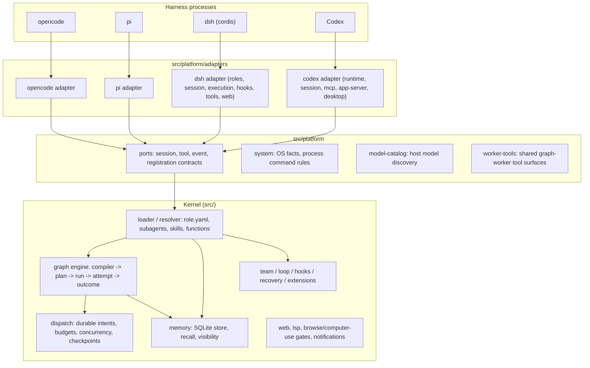

# System Architecture

## High-level architecture

rolebox is a **plugin kernel with host adapters**. All harness-specific code is
confined to `src/platform/adapters/<host>/`; everything else is host-agnostic
kernel logic that programs against ports defined in `src/platform/ports/`.

## Plugin composition pattern

Each entry point (`src/entries/*.ts`) follows the same shape:

1. Configure logging (`createSubLogger`, log directory from the host context).
2. Resolve rolebox directories for the workspace (`resolveRoleboxDirectories`).
3. Build a **single shared session adapter** and the host's graph host
   (`GraphApplication` from `src/graph/application`).
4. Register roles (agent registrar per host), skills, functions, and plugin hooks
   (`createPluginHooks` in `src/core/composition.ts`).
5. Apply project config (`loadProjectConfig` / `applyProjectConfig` from
   `src/project-config.ts`) — `.rolebox/config.json` in the workspace.

## The graph engine (multi-agent orchestration)

The graph engine is a **declarative, data-driven workflow engine** with a strict
one-directional pipeline:

```mermaid
flowchart LR
    DECL["Declaration (v3 YAML/JSON)"] --> COMP["Compiler: parse, capability preflight, structural guard"]
    COMP --> PLAN["Immutable compiled plan (topology authority)"]
    PLAN --> RUN["Run"]
    RUN --> ATT["Attempt"]
    ATT --> WORKER["Worker dispatch (durable intent)"]
    WORKER --> PROP["Outcome proposal (worker)"]
    PROP --> ACC["Acceptance: pinned gates judge proposal"]
    ACC --> COMMIT["Single transaction: state + effects (dispatch intents, notifications)"]
    COMMIT --> EFF["Effects delivered after commit"]
```

Host/kernel boundary:

- **Host supplies**: dispatch delivery, child-session start, session identity,
  execution observation/cancellation, validator/completion capabilities,
  credential store, approval policy.
- **Kernel owns**: compiler + preflight, state reducer (node status, joins
  `all`/`any`/`quorum`, loop progress), control application service (stop/retry/
  approval), ledger + store + single commit boundary, read model + audit + tool
  semantics.

Trust rules: a declaration may *request* a capability identity but never grant
one; a worker's payload is data, never authority; every identity (plan revision,
validator version, contract/policy revision, storage format) is matched exactly —
never "latest".

## Durable state

- **Graph state**: SQLite store (`src/graph/store`, `src/graph/persistence`,
  `src/graph/ledger`) rooted in one workspace store; dispatch intents and
  notification intents are durable rows committed with graph state in a single
  transaction, delivered only after commit.
- **Notification journal**: connection-local TEMP journal fed by SQLite triggers;
  scans only changed graphs; rolls back with the business transaction.
- **Memory**: `.rolebox/memory.db` per workspace with role/workspace visibility
  scopes (`src/memory/store.ts`, `schema.ts`, `visibility.ts`).
- **Worker authorization**: `OutcomeHost` retains a read-only store connection;
  commits from any writer invalidate derived values via SQLite `data_version`.

## Logging and events

`src/logger.ts` plus `src/log/` (sinks) define a structured logging architecture
with a boundary checker (`scripts/check-logging-boundaries.ts`). Cross-process
behavior is probed by `scripts/log-multiprocess-probe.ts`. The event bus lives in
`src/core/event-bus.ts`; hosts normalize their native events into rolebox events
(e.g. `normalizeOpencodeEvent`).

## Extensions and hooks

- Hooks (`src/hooks/`, custom in `src/hooks/custom/`): declarative event hooks
  (`chat.message`, `tool.execute.before/after`, `system.transform`, `event`) with
  priority, phase, and filters.
- Extensions (`src/extensions/`, points in `src/extensions/points/`): extension
  points in plugin assembly.
- Recovery (`src/recovery/`, strategies in `src/recovery/strategies/`,
  builtin): session error recovery, gated by built-in hooks like
  `session_error`.

## Capability gates

Browser and desktop automation are gated features: `src/loader/browse-use-gate.ts`
and `computer-use-gate.ts` check grants (`browse-grants.ts`,
`computer-grants.ts`) plus project config before exposing `browse`/`computer`
tools to a role.
