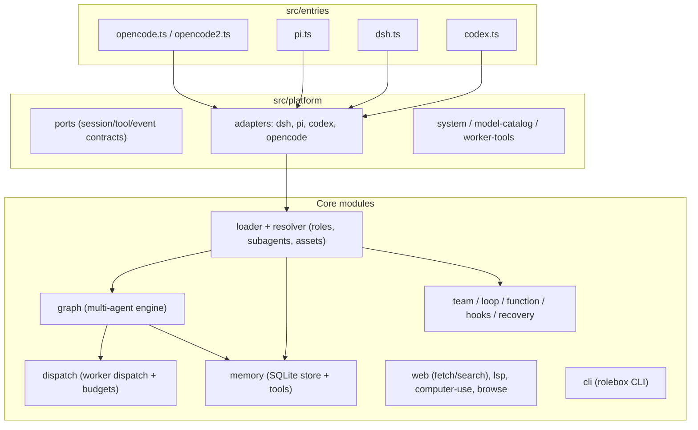

# Codebase Information

**Repository**: `juanrh/rolebox` (npm package `rolebox`, version 2.5.0)
**Language**: TypeScript (ESM, `"type": "module"`), single-language runtime code
**Runtime**: Node.js >= 26.4.0
**Package manager**: npm (`package-lock.json`, `npm@11.17.0`)
**License**: MIT

## What it is

rolebox is an agent plugin for four coding-agent harnesses — **opencode**, **pi**,
**DSH (DeepSeek Harness)** and **Codex** — that turns one coding agent into a
configured engineering team. Users declare specialist **roles** as YAML
(`role.yaml`), each with its own prompts, models, skills, permissions, functions,
hooks, subagents, memory configuration and dispatch budgets. Roles are run as
explicit multi-agent **graphs** with durable state in SQLite, and persistent
memory that survives sessions.

## Technology stack

| Layer | Technology |
| --- | --- |
| Runtime language | TypeScript 5.7+, strict, ESM with `.ts` import specifiers run via `tsx` |
| Test framework | Vitest 4 with isolated fork workers (`node --experimental-ffi`) |
| Build | Custom esbuild-based scripts (`scripts/build-all.ts`, `build-tui.ts`) — no standard tsc emit for `dist/` |
| Type checking | `tsc --noEmit` plus dedicated script/TUI test tsconfigs |
| TUI | `@opentui/core` + `@opentui/solid` + SolidJS |
| Validation | Zod 4 (CLI schemas), js-yaml (role YAML) |
| Durable state | SQLite (graph store, memory store `memory.db`) |
| Web fetching | cheerio, turndown, optional crawlee/playwright/linkedom/@mozilla/readability peers |
| CLI framework | citty |
| Process control | optional `node-pty` |

## Harness adapters (peer-coupled hosts)

| Host | Entry | Notes |
| --- | --- | --- |
| opencode | `src/entries/opencode.ts` (package `.`), `opencode2.ts` (`./server`) | Plugin via `@opencode-ai/plugin`; also `@opencode/plugin` v2 |
| pi | `src/entries/pi.ts` (`./pi`) | Extension via `pi.extensions` in package.json |
| dsh | `src/entries/dsh.ts` (`./dsh`) | Cordis plugin; web client bundle `./dsh` + `dsh/cordis.patch.yml` |
| codex | `src/entries/codex.ts` (`./codex`) | MCP/app-server based adapter |

## Structural map

## Key numbers / characteristics

- `src/` contains ~117 directories and ~727 TypeScript files across 35 top-level modules.
- Tests mirror source ownership (`tests/<module>/...`); CI runs the full randomized suite.
- Shipped with the npm package: `dist/`, `dsh/`, `examples/`, `functions/`, `skills/`.
- Documentation is extensive under `docs/` (~37 feature documents).
- Built-in configuration skill for agents: `skills/rolebox-config/`.
- CI workflows: `ci.yml`, `deprecate.yml`, `host-versions.yml` (daily host-version drift check).
