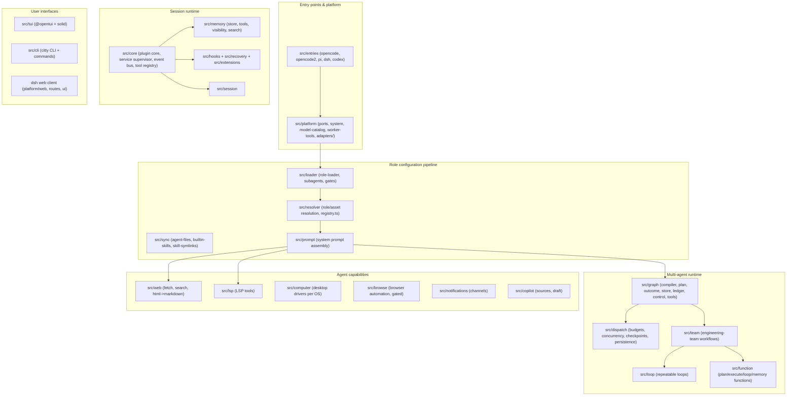

# Major Components

## Component map

## Component responsibilities

| Component | Path | Responsibility |
| --- | --- | --- |
| Entry points | `src/entries/` | Published harness entry points; plugin registration per host |
| Platform layer | `src/platform/` | Host contracts (ports), OS facts, model catalog, shared worker tools, per-host adapters |
| Role loader | `src/loader/role-loader.ts` | Parse `role.yaml`, validate fields, load prompts, resolve skills/functions/references, apply capability gates |
| Subagent loader | `src/loader/subagents.ts` | Inline child agents defined in `role.yaml` |
| Resolver | `src/resolver/` | Resolve role names to definitions; `registry.ts` holds `roleFunctionsMap` |
| Sync | `src/sync/` | Keep agent files, built-in skills and skill symlinks in sync with installed roles |
| Prompt assembly | `src/prompt/` | Compose system prompts: role prompt, memory summaries, workflow guidance, available assets |
| Graph engine | `src/graph/` | Declarative multi-agent workflows: compiler, immutable plans, outcome protocol, acceptance, durable store, controls |
| Dispatch | `src/dispatch/` | Worker dispatch as durable intents; budgets (tokens/cost per request/session), concurrency, checkpoints, progress |
| Team | `src/team/` | Engineering-team workflows (role teams, agent options, team store) |
| Loop | `src/loop/` | Repeatable loop execution across turns |
| Functions | `src/function/`, `functions/` | Packaged function definitions (plan, execute, loop, memory) merged into role toolsets |
| Core | `src/core/` | Plugin core, service supervisor, state registry, tool registry, event bus, composition root |
| Memory | `src/memory/` | Persistent workspace/role memory: SQLite store, tools (`memory_recall/read/list/write/update`), visibility, search |
| Hooks | `src/hooks/` | Builtin and custom event hooks with priority/phase/filters |
| Recovery | `src/recovery/` | Session-error recovery strategies |
| Extensions | `src/extensions/` | Extension points in plugin assembly |
| Web | `src/web/` | `web_fetch`/`web_search` tools; SSRF guard, bot detection, HTML→Markdown backends (cheerio/turndown, optional crawlee/playwright/readability) |
| LSP | `src/lsp/` | Language Server Protocol tools |
| Computer-use | `src/computer/` | Desktop automation drivers under `drivers/{darwin,linux,win32}/` with per-platform script manifests |
| Browse | `src/browse/` | Browser automation, gated by grants |
| Copilot | `src/copilot/` | Copilot feature sources and drafting |
| Notifications | `src/notifications/` | Notification channels |
| TUI | `src/tui/` | Terminal UI built on @opentui + SolidJS |
| CLI | `src/cli/` | `rolebox` CLI: init, install, update, list, search, registry, sync, status, info, logs, memory, monitor, checkpoint, bench, host, config, mcp |
| Terminal | `src/terminal/` | Terminal integration (incl. node-pty option) |
| Recording | `src/recording/` | Session recording |
| Hashline | `src/hashline/` | Line-hash based change tracking |
| Signal | `src/signal/` | Signal handling |
| Asset | `src/asset/` | Packaged asset loading |
| Benchmark | `src/benchmark/` | Benchmark hosts/infrastructure |
| Logging | `src/logger.ts`, `src/log/` | Structured logging with sinks and boundary rules |
| Project config | `src/project-config.ts` | `.rolebox/config.json` loading and application |

## Packaged non-code assets

| Path | Content |
| --- | --- |
| `skills/rolebox-config/` | The configuration skill shipped to agents (SKILL.md + `references/{configuration,roles,assets,orchestration,runtime}.md`) |
| `functions/*.md` | Function definitions: `execute.md`, `loop.md`, `memory.md`, `plan.md` |
| `examples/` | Working examples: `code-reviewer`, `review-team`, `review-team-custom`, `team-lead`, `tech-writer`, `computer-use`, `dsh`, `hooks` |
| `dsh/cordis.patch.yml` | Cordis bundle patch applied by the dsh host |
