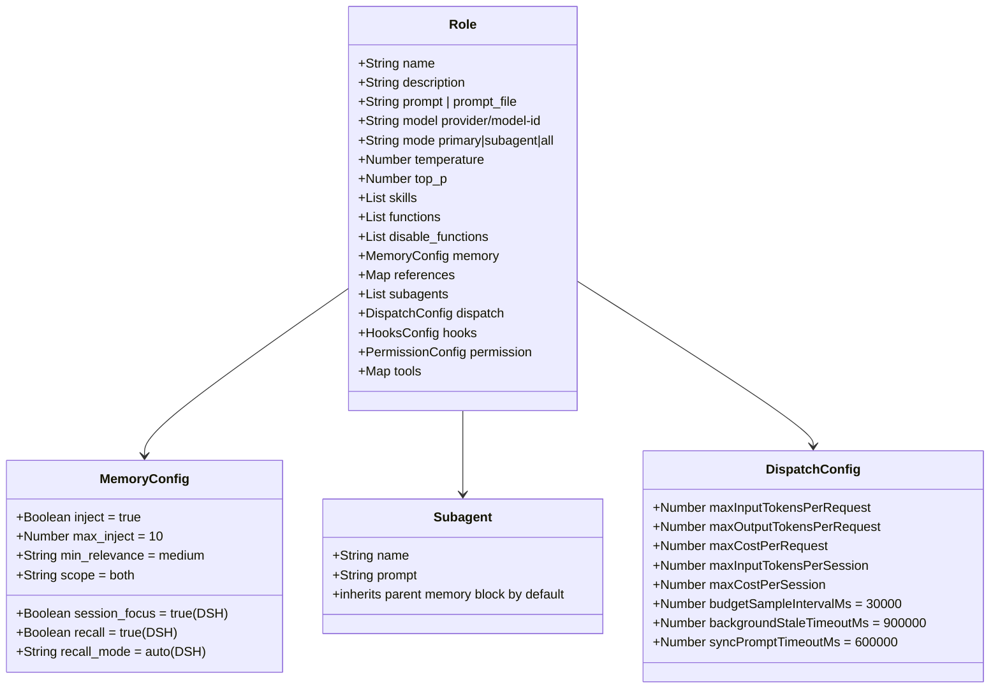

# Data Models

## Role definition model

The central user-facing data model is the **role** (`docs/role-yaml.md`,
validated by the loader). Schematic relationships:

Notes:
- `model:` is a canonical `provider/model-id` string: the provider is the segment
  before the first slash, the model id is everything after it (multi-segment ids
  survive intact).
- `functions` merge over built-in defaults `[plan, execute, loop]`;
  `disable_functions` removes built-ins.
- `permission.allow/deny` and `tools: {name: bool}` control tool availability.

## Graph data model

The graph engine's data flows declaration → compiled plan → run → attempt →
outcome proposal → acceptance decision → effects.

| Entity | Owner | Notes |
| --- | --- | --- |
| Graph declaration (v3) | `src/graph/compiler` | Parsed once; capability preflight; structural guard |
| Compiled plan | compiler | Immutable topology authority: canonical node/edge/loop order, pinned acceptance requirements, contract bindings, completion authorizations, terminal outcomes |
| Run / Attempt | `src/graph/domain`, `src/graph/outcome` | A run mints attempts; each attempt dispatches one worker |
| Outcome proposal | worker via protocol | Data only — never authority |
| Acceptance decision | `src/graph/outcome` acceptance core | Judged against pinned gates; commits with graph state in a single transaction |
| Effects | `src/graph/ledger` | Dispatch intents and notifications as durable rows, delivered only after commit |
| Graph state | `src/graph/store`, `src/graph/persistence` | SQLite; versioned body layouts, strict state codec, pure reducer for node-status transitions, joins (`all`/`any`/`quorum`), loop progress |
| Notification journal | store | Connection-local TEMP journal of changed graph ids, fed by SQLite triggers |
| Read model | `src/graph/query`, `src/graph/audit` | Shared read-only view, renderer, drain audit |

Identity rule: every identity (plan revision, validator version, contract or
policy revision, storage format) is matched exactly — never by ordering or
"latest".

## Memory data model

- Storage: workspace-scoped `.rolebox/memory.db` (SQLite; `src/memory/schema.ts`,
  `db-driver.ts`, `store.ts`).
- Entry fields: id, scope (`workspace` | `role`), keywords/summaries, full
  content, `source_sessions` (provenance; current session auto-recorded).
- Visibility enforced for model-facing recall/read/list/update operations,
  including reads by id.
- Relevance tiers: `low`, `medium`, `high`; injection capped by `max_inject`
  (0–100).

## Project configuration model

`.rolebox/config.json` per workspace (`src/project-config.ts`): project defaults,
automatic role activation, capability gates (browse/computer-use grants),
environment/config paths. Applied after role resolution.

## Registry model

`registry.yaml`: `{name, description, url, roles: {role-name: {version,
description, tags}}}` with roles as `roles/<name>/{role.yaml, skills/}`; git
tags for versions; optional branch/tag pinning per source.

## Dispatch models

- Budgets (`src/dispatch/budget`): token and cost caps per request and per
  dispatched session, sampled at `budgetSampleIntervalMs`.
- Checkpoints (`src/dispatch/checkpoint`): checkpoint types in
  `types.checkpoint.ts`; progress types in `types.progress.ts`.
- Dispatch intents: durable rows (see graph effects) — the platform starts a
  worker only after the intent exists.
