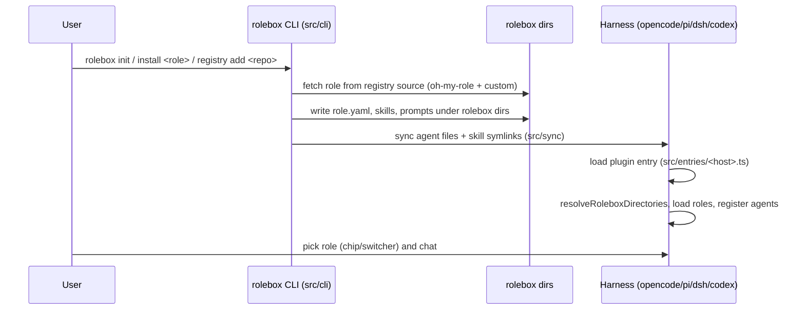
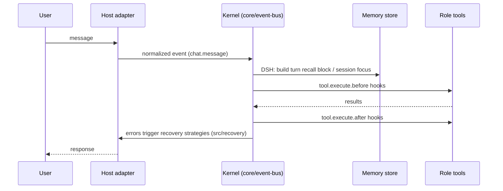
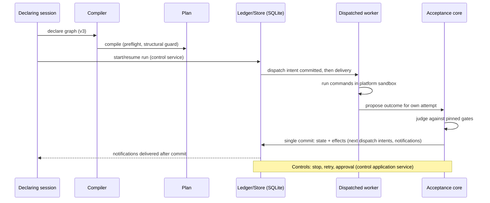

# Key Workflows

## 1. Installing and using a role



Installation is per-workspace; roles resolve from the rolebox directory
configuration (`docs/directory-structure.md`, `docs/configuration.md` topics in
the packaged skill).

## 2. Role loading and prompt assembly

```mermaid
flowchart TB
    A[role.yaml on disk] --> B[role-loader parses + validates]
    B --> C[Apply capability gates: browse / computer-use]
    C --> D[Resolve model against host catalog]
    D --> E[prompt assembly (src/prompt)]
    E --> F[role prompt + memory summaries + workflow guidance + available assets]
    F --> G[Register agent, skills, functions, hooks with host]
```

## 3. Session turn with role active



## 4. Multi-agent graph run



Key invariants: one-directional pipeline (declaration → plan → run → attempt →
proposal → acceptance → effects); dispatch is a durable intent before execution;
the kernel never starts an execution on its own; approvals are decided by the
named approver while the authorizing policy is installed.

## 5. Persistent memory workflow

1. Before repeating research, `memory_recall` by keywords.
2. `memory_read` the full entry by id; verify it still applies.
3. `memory_write` new durable decisions/preferences/facts/lessons (with
   `source_sessions` provenance) or `memory_update` by id.
4. Consolidation function (`functions: [memory]`) available in ordinary
   OpenCode/Pi sessions; in DSH, request consolidation directly.
5. Search or browse before creating a near-duplicate; preserve unresolved
   disagreements rather than overwriting.

## 6. Engineering-team workflow

`examples/review-team*/`, `examples/team-lead/`: a lead role declares a graph
dispatching specialist subagents (code-reviewer, tech-writer, etc.) with per-role
budgets; outcomes are accepted against the plan's gates. `src/team/` provides the
team runtime, store, and tools; `src/loop/` supports repeatable loops.

## 7. Capability-gated tools

`browse` and `computer` tools activate only when the grant and project config
allow it (`src/loader/*-gate.ts`). Computer-use uses per-OS drivers
(`src/computer/drivers/{darwin,linux,win32}/`) whose scripts are inlined by the
build. Browser-use has pluggable fetch backends (default cheerio/turndown;
optional crawlee/playwright).

## 8. Build and release workflow

- Build: `npm run build` → `scripts/build-all.ts` (esbuild-based) → `dist/`
  (library, TUI, dsh web client, entry aliases).
- Release: manual; no tag-triggered publish. `prepack` rewrites README links to
  absolute for npm; `postpack` restores relative.
- Host version policy: devDependencies track published channels; daily
  `host-versions.yml` workflow fails on drift; `npm run update:hosts` bumps.
